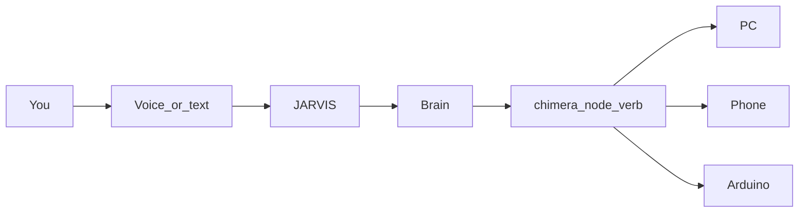

<p align="center">
  
</p>

<p align="center">
  <strong>Just A Rather Very Intelligent System.</strong><br>
  The hands, the voice, the mesh. Brain thinks. JARVIS makes the room move.
</p>

<p align="center">
  
  
  
  
  
  
</p>

<p align="center">
  <a href="ARCHITECTURE.md">Architecture</a> ·
  <a href="CONTRIBUTING.md">Contributing</a> ·
  <a href="SECURITY.md">Security</a> ·
  <a href="CHANGELOG.md">Changelog</a> ·
  <a href=".env.example">.env.example</a> ·
  <a href="https://github.com/Yash-200608/Brain">Brain</a>
</p>

> **Repo:** [`Yash-200608/Jarvis-2.0`](https://github.com/Yash-200608/Jarvis-2.0) (public).

---

## One house. Two kinds of truth.

Say *Hey Jarvis*. A window opens. A text leaves the phone. A node on the Tailscale mesh publishes what it can do.

That is embodiment. **Planning, memory, and permission live in [Brain](https://github.com/Yash-200608/Brain).** This repo is everything that touches silicon.



| What you feel | Who owns it |
|---|---|
| Wake word, STT, TTS, chat UI | JARVIS |
| Click, type, SMS, call, file, volume | JARVIS |
| Signed presence / command / response | `jarvis_node_sdk` ↔ Brain |
| Remember, plan, approve risk | **Brain only** |

---

## The islands — no mythology

Five codebases share this folder. They do not share a process. Test results below are from a clean clone, not from memory.

| Island | Status | Entry point | Needs | Test command → result | Last verified |
|---|---|---|---|---|---|
| **`jarvis_node_sdk`** | **Live.** Signed `chimera/<node>/<verb>` spine, tested against Brain. | `run_chimera_node.py` · offline: `scripts/smoke_chimera_node.py` | `requirements-chimera-node.txt`. A real node also needs a broker + `CHIMERA_NODE_ID`, `CHIMERA_HMAC_KEY`. | `pytest jarvis_node_sdk/tests -q` → 92 passed (Windows without symlink rights: 91 passed, 1 skipped) | CI, every push |
| **Legacy HTTP** | **Daily driver, legacy.** Flask + ADB. The one that actually runs the house today. | `hugginggpt/server/run_jarvis.ps1` | `hugginggpt/server/requirements_jarvis.txt`, Windows, ADB, an LLM key, [bridge tokens](#set-your-bridge-tokens) | `pytest test_jarvis.py test_legacy_invocation_log.py -q` (in `hugginggpt/server/`) → 12 passed, 15 skipped, **4 failed** — `TestRateLimiter` targets a rate limiter the bridge never had | 2026-10-12, clean clone |
| **Root `core/`** | Safety kernel. Tested, mostly unwired, known confirmation-order bug. | Library — no entry point | Standard library only | `pytest tests core/tests -q` → 40 passed | 2026-10-12, clean clone |
| **jarvis_prod** | **Draft.** MQTT, Telegram, cron, Langfuse. Not the Chimera contract. | `hugginggpt/server/jarvis_prod/run_jarvis.ps1` (PC), `start_agent.sh` (phone) | `jarvis_prod/requirements_pc.txt` / `requirements_phone.txt`, MQTT broker | `pytest hugginggpt/server/jarvis_prod/tests -q` → 6 passed | 2026-10-12, clean clone |
| **jarvis_core** | **Prototype.** Cognition half is retired as authority. | `jarvis_core/run_jarvis_core.py` | `jarvis_core/requirements.txt`, Ollama | None — `jarvis_core/tests/` holds only a conftest | — |

New hands go on the node SDK. Not a sixth planner.

---

## What it can do

| Surface | Examples |
|---|---|
| **PC** | Apps, type, click, scroll, screenshot, volume, lock, shutdown, files |
| **Phone** | SMS, call, tap/swipe, apps, screenshots (ADB or Termux) |
| **Voice** | *Hey Jarvis* → speak → hear it back |
| **Comms** | Email (IMAP/SMTP), WhatsApp Web, Telegram DM allowlist *(prod)* |
| **Web / media** | URLs, search, play/pause, transport keys |
| **Models** | HuggingFace caption / translate / summarize on the legacy path |
| **Mesh** | Presence, capabilities, signed commands on the Chimera spine |
| **Ops *(prod)*** | Full crontab via `croniter`, SQLite job log, reflector fail-streaks |

---

## Pick a door

### Recommended demo — two minutes, no hardware

The one path to try first. It drives the node's real signed command path with a throwaway key: no broker, no phone, no device actions, no environment variables. Python 3.11+.

```bash
git clone https://github.com/Yash-200608/Jarvis-2.0.git
cd Jarvis-2.0
python -m venv .venv
.venv\Scripts\activate                      # macOS/Linux: source .venv/bin/activate
pip install -r requirements-chimera-node.txt pytest
python scripts/smoke_chimera_node.py
pytest jarvis_node_sdk/tests -q
```

Expected:

```text
Chimera node smoke (offline: no broker, no device actions)
  [ ok ] signed ping        -> {'pong': True}  (signed reply, request_id echoed)
  [ ok ] unknown action     -> {'error': 'unknown_action'}
  [ ok ] forged signature   -> dropped, no reply
  [ ok ] tampered envelope  -> dropped, no reply
PASS 4/4
...
92 passed        # Windows without symlink rights: 91 passed, 1 skipped
```

CI runs both commands on every push. Next step up is a real node: `run_chimera_node.py` with a broker and `CHIMERA_NODE_ID` / `CHIMERA_HMAC_KEY` set (see its docstring).

### Everything else

| If you want… | Start here |
|---|---|
| It working this afternoon on USB Android | [Legacy HTTP stack](#running-jarvis--legacy-http-stack) |
| Phone-anywhere MQTT + Telegram + traces | [jarvis_prod](#running-jarvis--production-mqtt-stack-jarvis_prod) *(draft)* |
| The Chimera contract Brain already speaks | `jarvis_node_sdk/` + [ARCHITECTURE.md](ARCHITECTURE.md) |

For the hardware stacks, copy [`.env.example`](.env.example). Never put secrets in YAML. Legacy daily-driver install:

```bash
git clone https://github.com/Yash-200608/Jarvis-2.0.git
cd Jarvis-2.0
python -m venv venv && venv\Scripts\activate
pip install -r hugginggpt/server/requirements_jarvis.txt
```

Full install, tokens, and four-terminal launch: [Installation](#installation).

---

## Operator manual

1. [Architecture diagrams](#architecture)
2. [Prerequisites](#prerequisites)
3. [Installation](#installation)
4. [Configuration](#configuration)
5. [Required Environment Variables](#required-environment-variables)
6. [Running — Legacy HTTP](#running-jarvis--legacy-http-stack)
7. [Running — jarvis_prod](#running-jarvis--production-mqtt-stack-jarvis_prod)
8. [Actions reference](#available-actions-reference)
9. [Voice](#voice-commands)
10. [Android](#android-phone-control)
11. [Email & WhatsApp](#email--whatsapp-setup)
12. [LLM backends](#switching-llm-backends)
13. [Langfuse](#observability--langfuse-sdk-v4)
14. [Tests](#tests)
15. [Tree](#project-structure)
16. [Security](#security)
17. [Troubleshooting](#troubleshooting)
18. [Contributing](#contributing)

---

## Architecture

Island wiring — the daily driver and the draft MQTT stack. The Chimera contract is `jarvis_node_sdk/`, not these diagrams.

### Legacy HTTP-bridge stack

```
┌─────────────────────────────────────────────────────────────────┐
│                        YOU (User)                               │
│              Voice ("Hey Jarvis") or Text (chat)                │
└────────────────────────┬────────────────────────────────────────┘
                         │
                         ▼
┌─────────────────────────────────────────────────────────────────┐
│                   voice_module.py                               │
│  Mic → Wake Word → STT (Google/Whisper) → HTTP → TTS Response   │
└────────────────────────┬────────────────────────────────────────┘
                         │  POST /hugginggpt
                         ▼
┌─────────────────────────────────────────────────────────────────┐
│                   awesome_chat.py  (port 8004)                  │
│                                                                 │
│  ① Parse Task   →  ② Select Model  →  ③ Execute  →  ④ Respond   │
│                                                                 │
│  LLM Brain: Claude (claude_adapter.py) | Groq | OpenAI | Azure  │
└──────────┬────────────────────────────────────────┬─────────────┘
           │ HuggingFace Models                     │ Device Actions
           ▼                                        ▼
┌──────────────────────┐             ┌──────────────────────────────┐
│   models_server.py   │             │     device_integration.py    │
│   (port 8005)        │             │                              │
│  Image / Audio / NLP │             │  ┌────────────────────────┐  │
└──────────────────────┘             │  │   bridge_server.py     │  │
                                     │  │   (port 8092 — PC)     │  │
                                     │  │   30+ PC/email actions │  │
                                     │  └────────────────────────┘  │
                                     │  ┌────────────────────────┐  │
                                     │  │   phone_bridge.py      │  │
                                     │  │   (port 8091 — Android)│  │
                                     │  │   ADB commands         │  │
                                     │  └────────────────────────┘  │
                                     └──────────────────────────────┘
```

### Production MQTT stack (`jarvis_prod/`)

```
┌──────────────────┐                                ┌─────────────────────┐
│  Phone (Termux)  │                                │   PC (Windows)      │
│  agent_phone.py  │                                │   brain_pc.py       │
│                  │                                │                     │
│  ┌────────────┐  │   Tailscale (encrypted WAN)    │  ┌───────────────┐  │
│  │ aiomqtt    │  │ ─────────────────────────────► │  │ aiomqtt       │  │
│  │ QoS-1      │ ◄┼ ─────────────────────────────  │  │ correlator    │  │
│  │ session-LWT│  │     Mosquitto broker           │  │ QoS-1, LWT    │  │
│  └────────────┘  │   (jarvis/cmd, jarvis/resp)    │  └───────┬───────┘  │
│                  │                                │          │          │
│  Termux:API      │                                │   ┌──────▼──────┐   │
│  (sms/dial/      │                                │   │ awesome_chat│   │
│   battery/...)   │                                │   │  brain      │   │
└──────────────────┘                                │   └──────┬──────┘   │
                                                    │          │          │
                                                    │   ┌──────▼──────┐   │
                                                    │   │ Reflector   │   │
                                                    │   │ + JobLog    │   │
                                                    │   │ (SQLite)    │   │
                                                    │   └─────────────┘   │
                                                    │                     │
                                                    │   Telegram gateway  │
                                                    │   ◄── DM allowlist  │
                                                    │                     │
                                                    │   croniter scheduler│
                                                    │                     │
                                                    │   Langfuse v4 traces│
                                                    └─────────────────────┘
```

**Trace hierarchy (Langfuse v4):**

```
brain.prompt        (root, session=chat_id)
  ├─ awesome_chat.parse_device_command   (as_type="generation",
  │                                       model=llama-3.3-70b-versatile)
  └─ jarvis.send_command                 (per round-trip)
```

---

## Prerequisites

### All platforms
- Python **3.11+** (the prod stack uses `asyncio.TaskGroup`, `asyncio.timeout()`, `except*`)
- Git

### PC Bridge (`bridge_server.py`)
- Windows 10/11 (most actions), macOS/Linux (limited support)
- Gmail or Outlook account with App Password enabled (for email features)
- Chrome logged into WhatsApp Web (for WhatsApp features)

### Phone Bridge (`phone_bridge.py`, legacy stack)
- Android device with **USB Debugging enabled**
  - Settings → About Phone → tap Build Number 7× → Developer Options → Enable USB Debugging
- [Android Platform Tools (ADB)](https://developer.android.com/tools/releases/platform-tools) installed and on your system PATH
- USB cable connecting phone to PC

### Phone Agent (`agent_phone.py`, prod stack)
- Android device running [Termux](https://termux.dev/) with [Termux:API](https://wiki.termux.com/wiki/Termux:API) installed
- `pkg install python termux-api` inside Termux
- [Tailscale](https://tailscale.com/) account connecting phone and PC to the same tailnet
- Mosquitto broker (the launcher script auto-installs and configures it)

### Voice Module (`voice_module.py`)
- Microphone
- PortAudio (required by PyAudio):
  - Windows: installed automatically with `pip install pyaudio`
  - macOS: `brew install portaudio`
  - Linux: `sudo apt install portaudio19-dev`

### AI Brain
- An **Anthropic API key** — get one at [console.anthropic.com](https://console.anthropic.com), **or**
- A **Groq API key** (the prod stack uses `llama-3.3-70b-versatile` for device-command parsing)
- (Optional) A **HuggingFace token** for AI model tasks (image, audio, NLP)
- (Optional) A **Langfuse public + secret key pair** for end-to-end tracing

---

## Installation

### 1. Clone the repo

```bash
git clone https://github.com/Yash-200608/Jarvis-2.0.git
cd Jarvis-2.0
```

### 2. Create a virtual environment

```bash
python -m venv venv

# Windows
venv\Scripts\activate

# macOS/Linux
source venv/bin/activate
```

### 3. Install dependencies

```bash
# Core JARVIS extensions (Claude, PC control, voice, phone)
pip install -r hugginggpt/server/requirements_jarvis.txt

# Original HuggingGPT dependencies (AI model tasks)
pip install -r hugginggpt/server/requirements.txt

# Production MQTT stack (PC side)
pip install -r hugginggpt/server/jarvis_prod/requirements_pc.txt
```

> On the phone (Termux) for the prod stack, install `requirements_phone.txt` instead.

> **Note for PyAudio on Windows:** if `pip install pyaudio` fails, try:
> ```bash
> pip install pipwin
> pipwin install pyaudio
> ```

### 4. (Optional) Install Whisper for offline voice recognition

```bash
pip install openai-whisper
```

### 5. (Optional) Install ElevenLabs for natural-sounding voice responses

```bash
pip install elevenlabs
```

---

## Configuration

All settings live in `hugginggpt/server/configs/config.default.yaml`. **Secrets in this file are now `${VAR}` references** that resolve from the shell environment — they never sit in YAML on disk.

The config loader (`awesome_chat.py` and `models_server.py`) walks the loaded YAML recursively via `_expand_env_vars()` and calls `os.path.expandvars()` on every string. So `${GROQ_API_KEY}` in YAML becomes the value of `$GROQ_API_KEY` at load time.

### What's referenced as `${VAR}` in `config.default.yaml`

```yaml
# LLM brains
groq:
  api_key: ${GROQ_API_KEY}
huggingface:
  token: ${HF_TOKEN}

# Email & voice
email:
  password: ${GMAIL_APP_PASSWORD}
elevenlabs:
  api_key: ${ELEVENLABS_API_KEY}
```

### Set your bridge tokens

These are secret strings you choose — they authenticate the bridge servers. Like every other secret, they come from the environment:

```yaml
integrations:
  phone:
    token: ${JARVIS_PHONE_BRIDGE_TOKEN}
    relay:
      token: ${RELAY_TOKEN}
  computer:
    token: ${JARVIS_COMPUTER_BRIDGE_TOKEN}
```

Generate them once and export them in the shell that runs `run_jarvis.ps1` — the launcher hands the same values to the bridge processes and refuses to start bridges if either is unset:

```powershell
$env:JARVIS_PHONE_BRIDGE_TOKEN    = python -c "import secrets; print(secrets.token_urlsafe(32))"
$env:JARVIS_COMPUTER_BRIDGE_TOKEN = python -c "import secrets; print(secrets.token_urlsafe(32))"
$env:RELAY_TOKEN                  = python -c "import secrets; print(secrets.token_urlsafe(32))"   # -Relay mode only; phone_agent needs the same value
```

---

## Required Environment Variables

A commented template is in [`.env.example`](.env.example). Set these in your
shell (or a local `.env`) before launching anything. The repo will not read
secrets from YAML.

```powershell
# LLM brains
$env:GROQ_API_KEY       = 'gsk_...'         # Groq cloud (used by jarvis_prod)
$env:ANTHROPIC_API_KEY  = 'sk-ant-...'      # Claude (used by legacy stack)
$env:HF_TOKEN           = 'hf_...'          # HuggingFace, optional

# Email & voice
$env:GMAIL_APP_PASSWORD = '...'             # 16-char app password
$env:ELEVENLABS_API_KEY = 'sk_...'          # optional, natural TTS

# MQTT broker (jarvis_prod stack only)
$env:JARVIS_PASS        = '...'             # mosquitto broker password

# Telegram gateway (jarvis_prod stack, optional)
$env:TELEGRAM_BOT_TOKEN = '...'
$env:TELEGRAM_DM_ALLOWLIST = '12345,67890'  # comma-separated chat IDs

# Langfuse observability (optional, no-op if unset)
$env:LANGFUSE_PUBLIC_KEY = 'pk-lf-...'
$env:LANGFUSE_SECRET_KEY = 'sk-lf-...'
$env:LANGFUSE_HOST       = 'https://cloud.langfuse.com'
```

> **Why this matters:** earlier history of this repo had three live secrets committed (Gmail password, ElevenLabs key, an upstream GitHub PAT). They've been purged from HEAD **and** from full git history via `git filter-repo`. Rotate all three regardless — they were public for a few hours before the rewrite.

---

## Running JARVIS — Legacy HTTP Stack

JARVIS requires **up to 4 terminal windows** running simultaneously. Start them in this order.

### Terminal 1 — PC Bridge

```powershell
cd hugginggpt\server
$env:BRIDGE_TOKEN   = "my-computer-secret-token"   # must match config.yaml
$env:BRIDGE_DRY_RUN = "false"                       # "true" to test without real OS changes
python bridge_server.py --device computer --port 8092
```

Or use the included script:
```powershell
.\run_computer_bridge.ps1
```

You should see:
```
[bridge] 🟢  LIVE mode — OS commands WILL be executed.
[bridge] Listening on http://0.0.0.0:8092  (device=computer)
```

### Terminal 2 — Phone Bridge (skip if no Android device)

First, verify your phone is connected:
```bash
adb devices
# Should show:  XXXXXXXX    device
```

Then:
```powershell
$env:BRIDGE_TOKEN   = "my-phone-secret-token"
$env:BRIDGE_DRY_RUN = "false"
python phone_bridge.py --port 8091
```

Or:
```powershell
.\run_phone_bridge.ps1
```

### Terminal 3 — Main JARVIS Server

```bash
cd hugginggpt/server
python awesome_chat.py --config configs/config.default.yaml --mode cli
```

Wait for the server to start on port `8004`.

### Terminal 4 — Voice Module (speak to JARVIS)

```powershell
$env:ANTHROPIC_API_KEY = "sk-ant-YOUR_KEY"
python voice_module.py --server http://localhost:8004 --api-type claude
```

Or:
```powershell
.\run_voice.ps1
```

You'll hear: *"JARVIS online. Say 'Hey Jarvis' followed by your command."*

---

## Running JARVIS — Production MQTT Stack (`jarvis_prod`)

The prod stack runs the brain on your PC and a companion agent on the phone. They speak MQTT QoS-1 over Tailscale through a Mosquitto broker.

### Quick start (Windows, one-shot)

```powershell
cd hugginggpt\server\jarvis_prod
.\run_jarvis.ps1
```

The script:
1. Starts/configures Mosquitto with the password from `$env:JARVIS_PASS`
2. Launches `brain_pc.py` (with REPL, scheduler, Telegram gateway, Langfuse tracing)
3. Tails logs to `smoke.log` / `smoke_lf.log` / `smoke_noop.log`

To run the brain headless (no REPL):

```powershell
python brain_pc.py --no-repl --config ..\configs\config.default.yaml
```

### Phone-side setup (Termux)

```bash
# Inside Termux on the phone
pkg install python termux-api git
git clone https://github.com/Yash-200608/Jarvis-2.0.git
cd Jarvis-2.0/hugginggpt/server/jarvis_prod
pip install -r requirements_phone.txt

export JARVIS_PASS='...'           # same broker password as PC
export MQTT_HOST='100.x.y.z'       # Tailscale IP of the PC
bash start_agent.sh
```

Or for a long-running watchdog, point Tasker at `tasker_watchdog.txt`.

### What the prod stack gives you

- **`brain_pc.py`** — asyncio TaskGroup hosting the MQTT correlator (aiomqtt, QoS-1, session-expiry, LWT presence), REPL + `--no-repl` daemon mode, cron scheduler, Telegram gateway with DM allowlist + pairing, pentagi-style Reflector loop with SQLite-backed fail-streak memory, full Langfuse v4 tracing
- **`agent_phone.py`** — phone-side companion agent that handles SMS, dial, battery, screenshot, etc. via Termux:API
- **`scheduler.py`** — full crontab via `croniter` (ranges, names, `L`, `#`, lists, steps)
- **`jobs.py`** — SQLite `JobLog` with hot-path in-memory counter, hydrated on restart
- **`protocol.py`** — wire format (`Command` / `Response`, topic helpers, presence payload)
- **`telegram_gateway.py`** — DM bot with chat-ID allowlist + pairing flow
- **`_smoke.py`** — end-to-end round-trip test (brain + fake phone)
- **`run_jarvis.ps1`** — one-shot Windows launcher

### Smoke test

```bash
cd hugginggpt/server/jarvis_prod
python _smoke.py
# Expected: "round-trip OK" — green both with and without LANGFUSE_* env vars
```

When `LANGFUSE_*` env vars are unset, the tracing path drops to `contextlib.nullcontext` and adds zero overhead.

---

## Available Actions Reference

### PC Control

| Action | Key Parameters | Example |
|---|---|---|
| `open_app` | `app` (name) | Open Chrome |
| `run_command` | `command`, `shell` (auto/powershell) | Run `ipconfig` |
| `take_screenshot` | `region` (optional bbox) | Take a screenshot |
| `type_text` | `text`, `interval` | Type "Hello World" |
| `press_hotkey` | `keys` (list or string) | Press `["ctrl","c"]` |
| `move_mouse` | `x`, `y`, `duration` | Move mouse to 500,300 |
| `left_click` | `x`, `y` (optional) | Click at current position |
| `right_click` | `x`, `y` (optional) | Right-click |
| `double_click` | `x`, `y` (optional) | Double-click |
| `scroll` | `clicks` (+up/-down), `x`, `y` | Scroll down 3 clicks |
| `open_url` | `url` | Open `https://google.com` |
| `get_clipboard` | — | Read clipboard contents |
| `set_clipboard` | `text` | Copy text to clipboard |
| `minimize_window` | — | Minimize current window |
| `maximize_window` | — | Maximize current window |
| `close_window` | — | Close current window (Alt+F4) |

### System Control

| Action | Key Parameters | Example |
|---|---|---|
| `lock_device` | — | Lock the PC |
| `shutdown_device` | — | Shut down immediately |
| `restart_device` | — | Restart the PC |
| `set_volume` | `level` (0–100) | Set volume to 50 |
| `mute_audio` | `muted` (true/false) | Mute/unmute |
| `get_system_info` | — | CPU, RAM, disk, battery |
| `list_processes` | `name` (optional filter) | List running processes |
| `kill_process` | `name` or `pid` | Kill a process by name |

### File Management

| Action | Key Parameters | Example |
|---|---|---|
| `read_file` | `path` | Read contents of a file |
| `write_file` | `path`, `content`, `mode` (w/a) | Create or overwrite a file |
| `delete_file` | `path` | Delete a file or folder |
| `list_directory` | `path` | List folder contents |
| `search_files` | `root`, `pattern`, `content_query` | Find files by name or content |
| `copy_file` | `src`, `dst` | Copy a file |
| `move_file` | `src`, `dst` | Move a file |
| `create_directory` | `path` | Create a new folder |

### Email

| Action | Key Parameters | Example |
|---|---|---|
| `send_email` | `to`, `subject`, `body`, `html` | Send an email |
| `read_emails` | `folder`, `max_count`, `unread_only` | Read unread inbox |

### WhatsApp

| Action | Key Parameters | Example |
|---|---|---|
| `send_whatsapp` | `phone` (E.164), `message` | Send WhatsApp to `+1234567890` |

> Requires Chrome to be installed and already logged into [web.whatsapp.com](https://web.whatsapp.com).

### Media Control

| Action | `command` values | Example |
|---|---|---|
| `control_media` | `play`, `pause`, `next`, `previous`, `stop`, `volume_up`, `volume_down`, `mute` | Pause music |

---

## Voice Commands

After saying **"Hey Jarvis"** (or just **"Jarvis"**), speak your command naturally. JARVIS will figure out what to do.

### Example voice commands

```
"Hey Jarvis, open Chrome"
"Jarvis, take a screenshot"
"Hey Jarvis, send an email to mom saying I'll be home at 8"
"Jarvis, what's my CPU usage?"
"Hey Jarvis, send a WhatsApp to +1 555 123 4567 saying I'm on my way"
"Jarvis, turn the volume down to 30 percent"
"Hey Jarvis, find all Python files on my desktop"
"Jarvis, lock my computer"
"Hey Jarvis, stop listening"   ← puts voice module to sleep
```

### Voice settings

| Flag | Default | Options |
|---|---|---|
| `--stt` | `google` | `google`, `whisper` |
| `--tts` | `auto` | `auto`, `pyttsx3`, `elevenlabs`, `print` |
| `--whisper-model` | `base` | `tiny`, `base`, `small`, `medium`, `large` |

**Google STT** is faster but requires internet. **Whisper** runs fully offline (downloads ~150MB model on first use).

**pyttsx3** is the default TTS — it uses your system's built-in voices. **ElevenLabs** gives much more natural speech (requires `$env:ELEVENLABS_API_KEY`).

---

## Android Phone Control

Make sure ADB is working first (legacy stack):

```bash
adb devices
# List of devices attached
# R9JT701234A    device     ← good, device connected
```

### Example phone commands (via JARVIS chat or voice)

```
"Send a WhatsApp to +1 555 999 0000 saying I'll be late"
"Call +44 20 7946 0958"
"Open Spotify on my phone"
"Take a screenshot of my phone"
"Send an SMS to 07700900000 saying running 10 minutes late"
"Go to the home screen on my phone"
"Turn the phone volume to 8"
```

### Supported phone actions

| Action | Description |
|---|---|
| `send_sms` | Send SMS via Android Messages intent (legacy) / Termux:API (prod) |
| `send_whatsapp` | Open WhatsApp and pre-fill a message |
| `make_call` | Dial a phone number |
| `open_app` | Launch by package name or common name (e.g. "spotify") |
| `close_app` | Force-stop an app |
| `take_screenshot` | Capture phone screen, returns base64 PNG |
| `tap` | Tap at pixel coordinates (x, y) |
| `swipe` | Swipe between two points |
| `type_text` | Type on the focused field |
| `press_key` | Press hardware keys: home, back, volume_up, enter, etc. |
| `get_battery` | Battery level and charging status |
| `get_device_info` | Model, Android version, screen size |
| `set_volume` | Set media volume (0–15) |
| `list_apps` | List all installed packages |
| `push_file` | Copy a file from PC to phone |
| `pull_file` | Copy a file from phone to PC |

---

## Email & WhatsApp Setup

### Gmail (Recommended)

1. Enable 2-Step Verification on your Google Account
2. Go to [myaccount.google.com/apppasswords](https://myaccount.google.com/apppasswords)
3. Create an App Password for **Mail / Windows Computer**
4. Set it as `$env:GMAIL_APP_PASSWORD` (the YAML now reads `${GMAIL_APP_PASSWORD}`)

### Outlook / Hotmail

```yaml
email:
  smtp_host: smtp-mail.outlook.com
  smtp_port: 587
  imap_host: outlook.office365.com
  imap_port: 993
  username: you@outlook.com
  password: ${OUTLOOK_PASSWORD}     # exported in shell, not in YAML
```

### WhatsApp

JARVIS uses [pywhatkit](https://github.com/Ankit404butfound/PyWhatKit) to send WhatsApp messages via WhatsApp Web.

1. Open Chrome and go to [web.whatsapp.com](https://web.whatsapp.com)
2. Scan the QR code with your phone once
3. Leave Chrome open (it remembers the session)
4. JARVIS will now be able to send messages

Phone numbers must be in international format, e.g. `+14155552671`.

---

## Switching LLM Backends

### Claude (legacy stack default)

```yaml
anthropic:
  api_key: ${ANTHROPIC_API_KEY}
model: claude-sonnet-4-6    # or claude-opus-4-6, claude-haiku-4-5-20251001
```

### Groq (prod stack default)

```yaml
groq:
  api_key: ${GROQ_API_KEY}
model: llama-3.3-70b-versatile
```

### OpenAI

```yaml
openai:
  api_key: ${OPENAI_API_KEY}
model: gpt-4o
use_completion: false
```

### Azure OpenAI

```yaml
azure:
  api_key: ${AZURE_OPENAI_API_KEY}
  base_url: https://YOUR_RESOURCE.openai.azure.com
  deployment_name: YOUR_DEPLOYMENT
  api_version: "2024-02-01"
model: gpt-4
```

---

## Observability — Langfuse SDK v4

The prod stack ships full end-to-end tracing through Langfuse SDK v4.

### How it's wired

In `brain_pc.py`:

- **`_trace_obs(name, as_type=...)`** wraps `start_as_current_observation()` for span-style observations
- **`_trace_attrs(...)`** wraps `propagate_attributes()` for attaching session/user metadata to a subtree
- **`_lf_mask` callback** runs at SDK level for outbound payload scrubbing
- **Inline `_mask_params()`** runs before observation creation for second-layer PII scrubbing on inputs

Result: dual-layer masking. Phone numbers, message bodies, email contents, and broker passwords never appear in trace data.

### Trace hierarchy

```
brain.prompt              session=chat_id, user=...
├── awesome_chat.parse_device_command   as_type="generation"
│                                       model=llama-3.3-70b-versatile
└── jarvis.send_command                 (one per round-trip)
```

### No-op mode

If `LANGFUSE_PUBLIC_KEY` and `LANGFUSE_SECRET_KEY` are unset, every `_trace_obs(...)` falls through `contextlib.nullcontext` — zero overhead, zero allocations, zero network calls. The same code path runs whether tracing is on or off.

### Hardened HF status probe

`awesome_chat.get_model_status()` uses a pooled `requests.Session`:

```python
HTTPAdapter(pool_connections=16, pool_maxsize=32, max_retries=Retry(
    total=3, backoff_factor=0.5,
    status_forcelist=(429, 500, 502, 503, 504),
    allowed_methods=frozenset(["GET", "HEAD", "POST"]),
    raise_on_status=False,
))
```

Plus 60s/10s timeouts and a `try/except requests.RequestException` so transient network failures don't crash the probe thread.

---

## Tests

One suite per island, run from the repo root. Results from a clean clone on 2026-10-12 (Python 3.12); CI runs the first two lines plus a gitleaks secret scan on every push.

```bash
pytest jarvis_node_sdk/tests -q                  # 92 passed (91 + 1 symlink skip on Windows)
python scripts/smoke_chimera_node.py             # PASS 4/4 (offline, no device actions)
pytest tests core/tests -q                       # 40 passed
pytest hugginggpt/server/jarvis_prod/tests -q    # 6 passed
cd hugginggpt/server && pytest test_jarvis.py test_legacy_invocation_log.py -q
                                                 # 12 passed, 15 skipped, 4 failed (TestRateLimiter: never implemented)
```

The legacy suite is portable — heavy-dep modules are gated by `pytest.importorskip(...)` so they skip cleanly when `diffusers`, `flask`, or other optional packages aren't installed. The lazy-load helpers look like:

```python
def _awesome_chat():
    pytest.importorskip("diffusers", reason="awesome_chat requires diffusers")
    pytest.importorskip("flask",     reason="awesome_chat requires flask")
    import awesome_chat
    return awesome_chat
```

---

## Project Structure

```
Jarvis-2.0/
├── jarvis_node_sdk/                   ← Chimera signed MQTT node (live vs Brain)
├── docs/assets/banner.svg             ← This README's banner
├── hugginggpt/
│   └── server/
│       ├── awesome_chat.py            ← Main JARVIS brain (HuggingGPT pipeline)
│       ├── bridge_server.py           ← PC/email/WhatsApp bridge (port 8092, legacy)
│       ├── phone_bridge.py            ← Android ADB bridge (port 8091, legacy)
│       ├── voice_module.py            ← Voice input/output pipeline
│       ├── claude_adapter.py          ← Anthropic Claude API adapter
│       ├── device_integration.py      ← Bridge HTTP client (used by awesome_chat)
│       ├── models_server.py           ← Local HuggingFace model server
│       ├── test_jarvis.py             ← Portable test suite (importorskip-gated)
│       │
│       ├── jarvis_prod/               ← ⭐ Production MQTT stack
│       │   ├── brain_pc.py            ← MQTT correlator + REPL + Telegram + Reflector + Langfuse
│       │   ├── agent_phone.py         ← Phone-side Termux agent
│       │   ├── scheduler.py           ← croniter-based cron
│       │   ├── jobs.py                ← SQLite JobLog
│       │   ├── protocol.py            ← Wire format (Command / Response / presence)
│       │   ├── telegram_gateway.py    ← DM allowlist + pairing
│       │   ├── _smoke.py              ← End-to-end round-trip test
│       │   ├── run_jarvis.ps1         ← One-shot Windows launcher
│       │   ├── start_agent.sh         ← Termux phone agent launcher
│       │   ├── tasker_watchdog.txt    ← Tasker watchdog config
│       │   ├── mosquitto.conf.example ← Mosquitto broker template
│       │   ├── schedule.example.json  ← Example cron schedule
│       │   ├── requirements_pc.txt    ← PC-side deps (asyncio.TaskGroup, etc.)
│       │   └── requirements_phone.txt ← Termux deps
│       │
│       ├── configs/
│       │   ├── config.default.yaml    ← ⭐ Main config (uses ${VAR} env-var references)
│       │   ├── config.azure.yaml      ← Azure OpenAI template
│       │   ├── config.gradio.yaml     ← Gradio web UI config
│       │   └── config.lite.yaml       ← Lightweight / HuggingFace-only config
│       ├── demos/                     ← Few-shot examples for Claude/GPT
│       ├── data/
│       │   └── p0_models.jsonl        ← HuggingFace model registry
│       ├── run_computer_bridge.ps1    ← Launch PC bridge (legacy)
│       ├── run_phone_bridge.ps1       ← Launch phone bridge (legacy)
│       ├── run_voice.ps1              ← Launch voice module
│       ├── run_jarvis.ps1             ← Launch jarvis_prod brain
│       ├── requirements.txt           ← Original HuggingGPT deps
│       └── requirements_jarvis.txt    ← JARVIS extension deps
│
├── easytool/                          ← EasyTool benchmark module
├── taskbench/                         ← TaskBench evaluation module
└── README.md                          ← You are here
```

---

## Security

Reporting, historical leak notes, and operator rules: **[SECURITY.md](SECURITY.md)**.
The audited model (including known gaps) is [docs/architecture/SECURITY_MODEL.md](docs/architecture/SECURITY_MODEL.md).

- **No secrets in YAML.** Every credential reference in `config.default.yaml` is a `${VAR}` placeholder.
- **No `git add .`.** Stage explicit paths so `.env` and venv junk stay out.
- **Rotate historically leaked keys** (Gmail app password, ElevenLabs, upstream GitHub PAT) even though history was rewritten.

---

## Troubleshooting

### "No module named 'pyautogui'"
```bash
pip install pyautogui
```

### "No module named 'speech_recognition'"
```bash
pip install SpeechRecognition pyaudio
```

### PyAudio fails to install on Windows
```bash
pip install pipwin
pipwin install pyaudio
```

### ADB device not detected
1. Enable **USB Debugging** in Developer Options on your phone
2. Plug in the USB cable and accept the "Allow USB Debugging?" prompt on your phone
3. Run `adb kill-server && adb start-server && adb devices`
4. Try a different USB port or cable if still not detected

### WhatsApp message not sending
- Make sure Chrome is open and logged into [web.whatsapp.com](https://web.whatsapp.com)
- The phone number must include the country code: `+1XXXXXXXXXX`
- JARVIS schedules the message 1 minute in the future — wait for it

### Voice not recognizing speech
- Run with `--stt google` first to rule out Whisper issues
- Increase microphone sensitivity in Windows Sound Settings
- Speak clearly within 1 metre of the microphone
- If using `--stt whisper`, the first run downloads ~150MB — wait for it

### Claude API key errors
- Ensure the key starts with `sk-ant-`
- Check `$env:ANTHROPIC_API_KEY` is set in the same shell launching `awesome_chat.py`
- Make sure the `anthropic:` section in YAML references `${ANTHROPIC_API_KEY}` (or whatever var you exported)

### Bridge server returns `{"ok": false, "error": "Unauthorized"}`
- `JARVIS_PHONE_BRIDGE_TOKEN` / `JARVIS_COMPUTER_BRIDGE_TOKEN` must be set in the **same shell** that runs `run_jarvis.ps1`, so the bridges and `config.default.yaml` resolve the same values
- If you start a bridge by hand, its `BRIDGE_TOKEN` must **exactly** match the corresponding env var

### `${VAR}` shows up literal in logs / SMTP-AUTH fails
- The shell that launched the server didn't have the env var exported
- Re-export and restart the server (config is read once at startup)
- Verify with: `python -c "import os; print(os.path.expandvars('${GMAIL_APP_PASSWORD}'))"`

### MQTT broker connection refused (`jarvis_prod`)
- Confirm Mosquitto is running: `Get-Service mosquitto` (Windows) or `systemctl status mosquitto`
- `$env:JARVIS_PASS` must match the broker's password file
- Tailscale must be up on **both** PC and phone — verify with `tailscale status`

### Langfuse traces not appearing
- Check `LANGFUSE_PUBLIC_KEY`, `LANGFUSE_SECRET_KEY`, `LANGFUSE_HOST` are all set
- The first `_trace_obs(...)` call lazily initializes the SDK — give it a few seconds
- If `LANGFUSE_HOST` is self-hosted, check it's reachable from the brain's network namespace

### PyAutoGUI FailSafeException
PyAutoGUI is configured to abort if the mouse reaches a corner of the screen (a safety feature). Move the mouse away from the corner and retry.

---

## Contributing

Setup, island map, tests, and PR rules: **[CONTRIBUTING.md](CONTRIBUTING.md)**.
Architecture and Brain/JARVIS boundary: [ARCHITECTURE.md](ARCHITECTURE.md).

For a large change, open an issue first. New Chimera work goes in
`jarvis_node_sdk/`, not a new planner.

---

## Acknowledgements

This project builds on top of:
- [JARVIS / HuggingGPT](https://github.com/microsoft/JARVIS) by Microsoft Research
- [Anthropic Claude](https://www.anthropic.com) — reasoning brain (legacy stack)
- [Groq](https://groq.com) — `llama-3.3-70b-versatile` for device-command parsing (prod stack)
- [Langfuse](https://langfuse.com) — end-to-end observability via SDK v4
- [aiomqtt](https://github.com/sbtinstruments/aiomqtt) — async MQTT for the prod stack
- [croniter](https://github.com/kiorky/croniter) — full crontab parsing for the scheduler
- [pentagi](https://github.com/vxcontrol/pentagi) — inspiration for the Reflector loop
- [Tailscale](https://tailscale.com) — encrypted overlay network for phone↔PC
- [EasyTool](https://arxiv.org/abs/2401.06201) — tool learning benchmark
- [TaskBench](https://arxiv.org/abs/2311.18760) — task automation benchmark

---

*Built with Fun*
